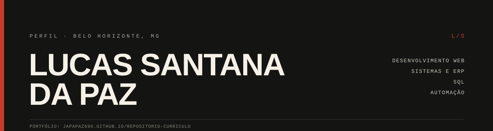

  

  <a href="https://japapaz696.github.io/Repositorio-Curriculo/">Portfólio</a> ·
  <a href="https://www.linkedin.com/in/lucas-santana-da-paz-215816247/">LinkedIn</a> ·
  <a href="mailto:lucaspaz696@gmail.com">E-mail</a>

## Entre sistemas e interfaces

Estudante de **Análise e Desenvolvimento de Sistemas** na Newton Paiva, em Belo Horizonte, com conclusão prevista para 2027.

Minha experiência profissional vem do **suporte ao ERP TecFood, na Teknisa**: atendimento a usuários, acompanhamento de chamados, consultas SQL para verificação de registros e investigação de inconsistências. Nos projetos próprios, aplico esse olhar de operação na construção de interfaces web — e procuro deixar claro o que está publicado, o que é demonstração e o que ainda é estudo.

**Buscando oportunidades de entrada em:** Analista de Sistemas Júnior · Suporte ERP · Desenvolvimento Web · Automação com IA.

---

## 01 — Experiência

**Teknisa** · Estágio em Suporte Técnico ao ERP TecFood
Atendimento técnico a usuários, acompanhamento de chamados, consultas SQL para verificação de registros e apoio à investigação de causas de incidentes em software de gestão.

**Newcity Car** · Vistoriador veicular (2024–2025)

**Pirelli** · Logística (2021)

---

## 02 — Stack

| Área | Como aparece no meu trabalho |
|---|---|
| Suporte a ERP e atendimento técnico | Rotina profissional de suporte ao TecFood, com acompanhamento de chamados e contato com usuários |
| SQL | Consultas para verificação de registros e diagnóstico de divergências no suporte; laboratório de SQL com 10 cenários de ERP |
| HTML5, CSS3 e JavaScript | Portfólio e demonstrações web publicadas |
| Git, GitHub e GitHub Pages | Versionamento, repositórios públicos e publicação do portfólio |
| React, TypeScript e Vite | Front-end do SupportFlow |
| Node.js, Express e PostgreSQL | Backend, API e persistência do SupportFlow |
| Testes | Vitest e Supertest no SupportFlow; `node:test` nas regras de agendamento do Seu Manoel e no tratamento de senha da barbearia |
| n8n, APIs e LLMs | Estudos e experimentos de automação, sem integração em produção |

---

## 03 — Projetos

| Projeto | O que é | Estágio | Links |
|---|---|---|---|
| **Portfólio pessoal** | Site editorial com trajetória, competências, projetos e demonstrações navegáveis | Publicado | [Código](https://github.com/Japapaz696/Repositorio-Curriculo) · [Site](https://japapaz696.github.io/Repositorio-Curriculo/) |
| **SupportFlow** | Sistema de chamados full-stack com autenticação JWT, quatro perfis de acesso, SLA por prioridade, comentários, dashboard e diagnóstico técnico | Em desenvolvimento · **116 testes** e CI verde | [Código](https://github.com/Japapaz696/SupportFlow) |
| **SQL Lab** | Laboratório de SQL para diagnóstico e suporte a ERP: 10 cenários com consultas PostgreSQL que rodam de verdade sobre um banco de vendas, pedidos, produtos, pagamentos, estoque e chamados | MVP · **108 testes**, separação de privilégios no banco e CI verde | [Código](https://github.com/Japapaz696/sql-lab) |
| **Site-veronica** | Agendamento de consultas com persistência em PostgreSQL, sessão administrativa em cookie `HttpOnly` e token opaco por paciente | Em desenvolvimento · **90 testes** | [Código](https://github.com/Japapaz696/Site-veronica) |
| **Barbearia** | Demo de agendamento e fidelidade para barbearia, com PWA, área do cliente e painel administrativo | Publicado · senha guardada como derivador PBKDF2, 10 testes | [Código](https://github.com/Japapaz696/barbearia) · [Site](https://japapaz696.github.io/barbearia/) |
| **Portfolio Anna** | Site pessoal multipágina com identidade visual, navegação mobile, animações e galeria com lightbox | Publicado | [Código](https://github.com/Japapaz696/Portfolio-Anna) · [Site](https://japapaz696.github.io/Portfolio-Anna/) |
| **Lucas Dev** | Landing page de serviços com configurador de orçamento e contato por WhatsApp | Publicado · demonstração front-end | [Código](https://github.com/Japapaz696/Lucas) · [Site](https://japapaz696.github.io/Lucas/) |

**Demos dentro do portfólio:** [Seu Manoel](https://japapaz696.github.io/Repositorio-Curriculo/projetos/seu-manoel/) (agendamento com regras e testes) · [Papitos](https://japapaz696.github.io/Repositorio-Curriculo/projetos/papitos/) (cardápio e carrinho) · [Beauty Store](https://japapaz696.github.io/Repositorio-Curriculo/projetos/beauty-store/) (catálogo e checkout simulado).

---

## 04 — Transparência

- **Publicado e navegável:** portfólio, Portfolio Anna, Lucas Dev, a barbearia e as três demos embutidas.
- **Backend real:** o SupportFlow tem API Express, PostgreSQL com migrations, autenticação JWT, controle de acesso e **116 testes** — 80 de integração contra PostgreSQL 16 real, 26 de interface e 10 de contrato. O fluxo completo foi validado localmente, incluindo as permissões de cada perfil e o controle de acesso da interface. O Site-veronica acrescenta 90 testes (80 sem banco e 11 contra PostgreSQL) e a barbearia, 10.
- **Demonstração no navegador:** Papitos, Beauty Store e Seu Manoel usam `localStorage`. Não há pagamento, frete, estoque ou agenda multiusuário em produção.
- **Simulação:** os experimentos de IA do laboratório são interfaces e cenários locais; não representam integrações ativas com modelos, CRMs ou WhatsApp Business.
- **Dados:** capturas e demonstrações usam dados fictícios. Não publico dados de clientes ou pacientes em exemplos do portfólio.
- **Limite conhecido:** a verificação de login da barbearia acontece no navegador, como todo protótipo sem backend. A senha não é gravada em texto puro — fica um derivador PBKDF2 — mas a proteção real exigiria a verificação no servidor.

---

## 05 — Contato

Estou aberto a oportunidades de entrada e a conversas sobre suporte, sistemas e desenvolvimento web.

[Portfólio](https://japapaz696.github.io/Repositorio-Curriculo/) · [LinkedIn](https://www.linkedin.com/in/lucas-santana-da-paz-215816247/) · [lucaspaz696@gmail.com](mailto:lucaspaz696@gmail.com)

README revisado em outubro de 2026.
