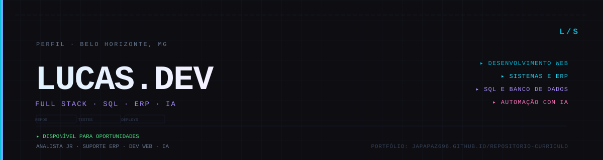

# Lucas Santana da Paz — LUCAS.DEV

  

  <a href="https://japapaz696.github.io/Repositorio-Curriculo/">Portfólio</a> ·
  <a href="https://www.linkedin.com/in/lucas-santana-da-paz-215816247/">LinkedIn</a> ·
  <a href="mailto:lucaspaz696@gmail.com">lucaspaz696@gmail.com</a>

## 👋 Entre Sistemas e Interfaces

**Lucas Santana da Paz**  
Estudante de **Análise e Desenvolvimento de Sistemas** na Newton Paiva, Belo Horizonte, previsão 2027.

**Experiência profissional:** Suporte ao ERP TecFood (Teknisa) — atendimento a usuários, acompanhamento de chamados, consultas SQL para verificação de registros e investigação de inconsistências.  
**Buscando oportunidades:** Analista de Sistemas Júnior · Suporte ERP · Desenvolvimento Web · Automação com IA.

---

## 🛠️ Tech Stack

| Área | Tecnologias |
|------|-------------|
| Suporte ERP e atendimento técnico | Rotina profissional de suporte ao TecFood, com acompanhamento de chamados e contato com usuários |
| SQL | Consultas para verificação de registros e diagnóstico de divergências; laboratório de SQL com 10 cenários de ERP |
| HTML5, CSS3 e JavaScript | Portfólio e demonstrações web publicadas |
| Git, GitHub e GitHub Pages | Versionamento, repositórios públicos e publicação do portfólio |
| React, TypeScript e Vite | Front-end do SupportFlow |
| Node.js, Express e PostgreSQL | Backend, API e persistência do SupportFlow |
| Testes | Vitest e Supertest no SupportFlow; `node:test` nas regras de agendamento do Seu Manoel e no tratamento de senha da barbearia |
| n8n, APIs e LLMs | Estudos e experimentos de automação, sem integração em produção |

---

## 🚀 SQL Lab — Em Destaque

**Laboratório de SQL para diagnóstico e suporte a ERP:** 10 cenários com consultas PostgreSQL que rodam de verdade sobre um banco de vendas, pedidos, produtos, pagamentos, estoque e chamados. **108 testes** validados, separação de privilégios no banco e CI verde.

- [Código no GitHub](https://github.com/Japapaz696/sql-lab)
- Banco PostgreSQL real com 10 cenários de ERP
- MVP com CI verde

---

## 📁 Projetos

| Projeto | Descrição | Estágio | Links |
|---------|-----------|---------|-------|
| **Portfólio pessoal** | Site editorial com trajetória, competências, projetos e demonstrações navegáveis | Publicado | [Código](https://github.com/Japapaz696/Repositorio-Curriculo) · [Site](https://japapaz696.github.io/Repositorio-Curriculo/) |
| **SupportFlow** | Sistema de chamados full-stack com autenticação JWT, quatro perfis de acesso, SLA por prioridade, comentários, dashboard e diagnóstico técnico | Em desenvolvimento · **196 testes** e CI verde | [Código](https://github.com/Japapaz696/SupportFlow) |
| **Site-veronica** | Agendamento de consultas com persistência em PostgreSQL, sessão administrativa em cookie `HttpOnly` e token opaco por paciente | Em desenvolvimento · **90 testes** | [Código](https://github.com/Japapaz696/Site-veronica) |
| **Barbearia** | Demo de agendamento e fidelidade para barbearia, com PWA, área do cliente e painel administrativo | Publicado · senha guardada como derivador PBKDF2, 10 testes | [Código](https://github.com/Japapaz696/barbearia) · [Site](https://japapaz696.github.io/barbearia/) |
| **Portfolio Anna** | Site pessoal multipágina com identidade visual, navegação mobile, animações e galeria com lightbox | Publicado | [Código](https://github.com/Japapaz696/Portfolio-Anna) · [Site](https://japapaz696.github.io/Portfolio-Anna/) |
| **Lucas Dev** | Landing page de serviços com configurador de orçamento e contato por WhatsApp | Publicado · demonstração front-end | [Código](https://github.com/Japapaz696/Lucas) · [Site](https://japapaz696.github.io/Lucas/) |

**Demos dentro do portfólio:**  
[Seu Manoel](https://japapaz696.github.io/Repositorio-Curriculo/projetos/seu-manoel/) (agendamento com regras e testes) ·  
[Papitos](https://japapaz696.github.io/Repositorio-Curriculo/projetos/papitos/) (cardápio e carrinho) ·  
[Beauty Store](https://japapaz696.github.io/Repositorio-Curriculo/projetos/beauty-store/) (catálogo e checkout simulado).

---

## 📅 Timeline

**2021 — Logística**  
Pirelli — Atuação em operações logísticas e gestão de materiais.

**2024–2025 — Vistoriador Veicular**  
Newcity Car — Inspeções veiculares e registro de condições de frota.

**2024–Atual — Suporte ERP**  
Teknisa — Suporte Técnico ao ERP TecFood: atendimento, chamados, consultas SQL e análise de divergências.

**2027 (Previsão) — Conclusão de ADS**  
Newton Paiva — Análise e Desenvolvimento de Sistemas, Belo Horizonte.

---

## 📊 Estatísticas do GitHub

| Indicador | Valor |
|-----------|-------|
| Repositórios públicos | 19 |
| Linguagens principais | TypeScript, JavaScript, HTML, CSS |
| Commits no perfil | 12 |
| Última atualização do perfil | outubro de 2026 |
| Repositório em destaque | [SQL Lab](https://github.com/Japapaz696/sql-lab) |

---

## 🔍 Transparência

- **Publicado e navegável:** portfólio, Portfolio Anna, Lucas Dev, a barbearia e as três demos embutidas.
- **Backend real:** o SupportFlow tem API Express, PostgreSQL com migrations, autenticação JWT, controle de acesso e **196 testes** — 110 de integração contra PostgreSQL 16 real, 21 de middleware de segurança, 45 de interface e 20 de contrato. O fluxo completo foi validado com navegador real nos quatro perfis (solicitante, agente, gestor e administrador), incluindo as permissões de cada perfil, o controle de acesso da interface e o comportamento sob erro de rede e sessão expirada. O Site-veronica acrescenta 90 testes (47 de segurança, 18 de XSS no front-end, 14 do repositório e 11 de API) e a barbearia, 10.
- **Demonstração no navegador:** Papitos, Beauty Store e Seu Manoel usam `localStorage`. Não há pagamento, frete, estoque ou agenda multiusuário em produção.
- **Simulação:** os experimentos de IA do laboratório são interfaces e cenários locais; não representam integrações ativas com modelos, CRMs ou WhatsApp Business.
- **Dados:** capturas e demonstrações usam dados fictícios. Não publico dados de clientes ou pacientes em exemplos do portfólio.
- **Limite conhecido:** a verificação de login da barbearia acontece no navegador, como todo protótipo sem backend. A senha não é gravada em texto puro — fica um derivador PBKDF2 — mas a proteção real exigiria a verificação no servidor.

---

## 🎓 Certificações

> **Nota de transparência:** nenhum certificado formal concluído foi verificado até a data. Cursos em andamento ou estudos autodidatas (n8n, APIs, LLMs, SQL avançado) são indicados como estudos, sem declaração de conclusão.

---

## 📬 Contato

Estou aberto a oportunidades de entrada e a conversas sobre suporte, sistemas e desenvolvimento web.

  <a href="https://japapaz696.github.io/Repositorio-Curriculo/">Portfólio</a> ·
  <a href="https://www.linkedin.com/in/lucas-santana-da-paz-215816247/">LinkedIn</a> ·
  <a href="mailto:lucaspaz696@gmail.com">lucaspaz696@gmail.com</a>

README atualizado em novembro de 2026.